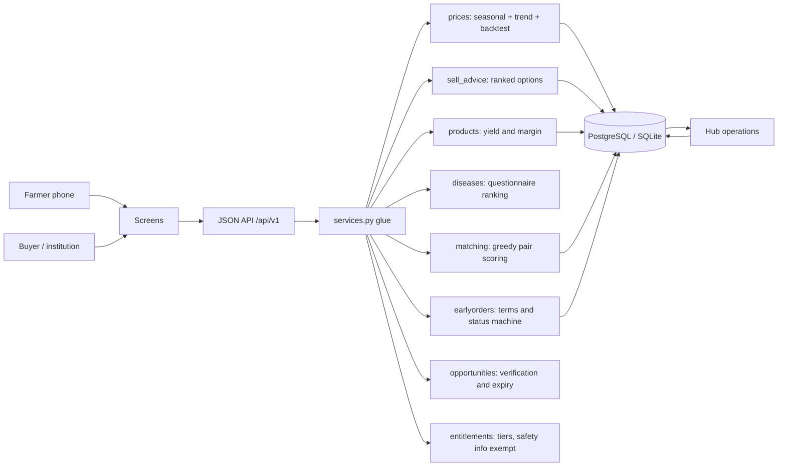

# Architecture

The proposal (section 7) asks for a mobile-first front end, a FastAPI backend,
a relational store, and a separation between the intelligence layer and the
physical Hub. This prototype follows that shape, and keeps the reasoning in
plain Python modules so each rule can be tested and argued about on its own.

## Shape

```
                         ┌──────────────────────────────────────────────┐
  farmer / buyer         │  Screens (Jinja, mobile-first, no JS needed)│
  on a phone  ──────────▶│  /dashboard  /farm-doctor  /when-to-sell     │
                         │  /early-orders  /marketplace  /hub           │
                         │  /opportunities  /prices  /tiers             │
                         └───────────────────┬──────────────────────────┘
                                             │ same data, one source of truth
                         ┌───────────────────▼──────────────────────────┐
  SMS / WhatsApp bridge  │  JSON API  /api/v1/*  (FastAPI + Pydantic)   │
  or a later mobile app ─▶  validation, status codes, refusals          │
                         └───────────────────┬──────────────────────────┘
                                             │
                         ┌───────────────────▼──────────────────────────┐
                         │  app/services.py  -  DB <-> engines glue    │
                         └───────────────────┬──────────────────────────┘
                                             │ pure functions, no ORM inside
   ┌─────────────────────────────────────────┼─────────────────────────────────────┐
   │                 app/engine/ - the intelligence layer                            │
   │  prices.py       sell_advice.py  products.py  diseases.py                       │
   │  matching.py     earlyorders.py  opportunities.py  entitlements.py              │
   └─────────────────────────────────────────┬───────────────────────────────────────┘
                                             │
                         ┌───────────────────▼──────────────────────────┐
                         │  SQLAlchemy models (app/models.py)          │
                         │  SQLite for the demo / PostgreSQL in        │
                         │  production (DATABASE_URL)                 │
                         └──────────────────────────────────────────────┘
                                             │
                         ┌───────────────────▼──────────────────────────┐
                         │  MatookeSmart Hub (physical arm)            │
                         │  HubBuyingNotice + ProductTrial records     │
                         │  are the only digital surface it needs      │
                         └──────────────────────────────────────────────┘
```

Mermaid version of the same flow:



## Why the engines are pure functions

Every module in `app/engine/` takes plain dataclasses or dicts and returns
plain data. Nothing in that folder imports SQLAlchemy or FastAPI. Three
reasons that matter for this project:

1. **Testable without infrastructure.** 129 tests use an isolated in-memory SQLite database, no network and no torch.
2. **Arguable.** The proposal says a prediction must show its limits. Because
   the confidence, MAPE and caveats are returned *as data*, the UI cannot
   quietly drop them; a test can assert they arrive.
3. **Replaceable.** When real data arrives, `prices.forecast_prices` can grow
   into a GradientBoosting or seasonal-ARIMA model without touching a single
   screen; an image model would require independent validation and careful integration before use.

## The data flow for one decision

`GET /api/v1/farms/{id}/advice` composes four modules in the order the
proposal's example farmer journey (section 6) uses them:

1. pick the market nearest the farm's district, load its price history;
2. fit the price model, backtest it, derive confidence and the range;
3. look at open buyer requirements to see what demand actually exists;
4. ask the Hub what it is currently buying, and rank processing options using
   measured trials where they exist;
5. return a headline, a primary route, and every option with its own revenue,
   cash-now figure, certainty label and risks.

The screens and API use shared services, although their response shapes differ.

## Storage

| Concern | Choice | Why |
| --- | --- | --- |
| Rows | SQLAlchemy 2.0 typed models | one model file, works on SQLite and Postgres |
| Dev / demo | SQLite file in `data/` | a student demo must run with one command |
| Pilot / production | `DATABASE_URL=postgresql+psycopg://...` | section 7 asks for Postgres |
| Audit | `forecast_run`, `order_event`, `match_run`, `product_trial` | the MVP must be measurable, and disputes need a record |
| Consent | `consent_profile`, `consent_images`, `consent_contact` on `person` | Data Protection and Privacy Act 2019 |
| Migrations | `Base.metadata.create_all` for the prototype; Alembic when real users exist | honesty about what is not built |

## Deliberate non-features

No authentication, no payment movement, no SMS sending, no image model, no
escrow. Each is out of scope for a coursework prototype or needs a licensed
partner (sections 12 and 13), and the app says so on the screens that would
otherwise imply it.

## v0.2 additions (structure, not behaviour)

- `app/routers/` - new routers live here; `routers/system.py` serves `/system` and `/api/v1/system`.
- `app/logical_model.py` - the logical data model, read live from the SQLAlchemy metadata and
  rendered on `/system` and in `docs/LOGICAL_MODEL.md` (`python -m scripts.gen_logical_model`).
- `app/middleware.py` - request IDs, security headers (CSP), per-client write rate limit.
- `app/errors.py` - JSON errors for `/api`, readable pages for screens, no stack traces.
- The farm doctor and price forecast are **unchanged prototypes** and are labelled as such in the UI.
