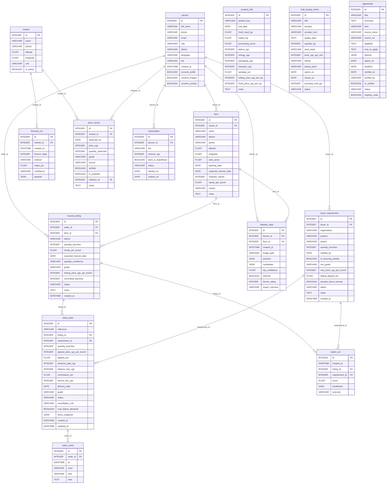

# Logical data model

Generated from `app/models.py` by `scripts/gen_logical_model.py`. Do not edit by hand.

## People and access (5.7)

### `person`

| Field | Type | Key |
| --- | --- | --- |
| id | INTEGER | PK |
| full_name | VARCHAR |  |
| phone | VARCHAR |  |
| email | VARCHAR |  |
| role | VARCHAR |  |
| district | VARCHAR |  |
| language | VARCHAR |  |
| tier | VARCHAR |  |
| created_at | DATETIME |  |
| consent_profile | BOOLEAN |  |
| consent_images | BOOLEAN |  |
| consent_contact | BOOLEAN |  |

### `subscription`

| Field | Type | Key |
| --- | --- | --- |
| id | INTEGER | PK |
| person_id | INTEGER | FK -> person |
| tier | VARCHAR |  |
| amount_ugx | INTEGER |  |
| price_is_hypothesis | BOOLEAN |  |
| status | VARCHAR |  |
| started_on | DATE |  |
| expires_on | DATE |  |

### `farm`

| Field | Type | Key |
| --- | --- | --- |
| id | INTEGER | PK |
| owner_id | INTEGER | FK -> person |
| name | VARCHAR |  |
| district | VARCHAR |  |
| parish | VARCHAR |  |
| latitude | FLOAT |  |
| longitude | FLOAT |  |
| area_acres | FLOAT |  |
| planting_date | DATE |  |
| expected_harvest_date | DATE |  |
| matooke_stands | INTEGER |  |
| hands_per_bunch | FLOAT |  |
| variety | VARCHAR |  |
| notes | TEXT |  |

## Market intelligence (5.2)

### `market`

| Field | Type | Key |
| --- | --- | --- |
| id | INTEGER | PK |
| name | VARCHAR |  |
| district | VARCHAR |  |
| latitude | FLOAT |  |
| longitude | FLOAT |  |
| unit | VARCHAR |  |
| is_active | BOOLEAN |  |

### `price_record`

| Field | Type | Key |
| --- | --- | --- |
| id | INTEGER | PK |
| market_id | INTEGER | FK -> market |
| observed_on | DATE |  |
| price_ugx | INTEGER |  |
| quantity_observed | INTEGER |  |
| grade | VARCHAR |  |
| source | VARCHAR |  |
| verified | BOOLEAN |  |
| is_synthetic | BOOLEAN |  |
| collector_id | INTEGER | FK -> person |
| notes | TEXT |  |

### `forecast_run`

| Field | Type | Key |
| --- | --- | --- |
| id | INTEGER | PK |
| market_id | INTEGER | FK -> market |
| created_at | DATETIME |  |
| horizon_days | INTEGER |  |
| method | VARCHAR |  |
| mape_pct | FLOAT |  |
| confidence | VARCHAR |  |
| payload | JSON |  |

## Farm doctor (5.1)

### `disease_case`

| Field | Type | Key |
| --- | --- | --- |
| id | INTEGER | PK |
| farmer_id | INTEGER | FK -> person |
| farm_id | INTEGER | FK -> farm |
| created_at | DATETIME |  |
| image_path | VARCHAR |  |
| answers | JSON |  |
| candidates | JSON |  |
| top_confidence | FLOAT |  |
| referred | BOOLEAN |  |
| farmer_rating | INTEGER |  |
| expert_outcome | VARCHAR |  |

## Hub and products (5.3)

### `product_trial`

| Field | Type | Key |
| --- | --- | --- |
| id | INTEGER | PK |
| product_key | VARCHAR |  |
| trial_date | DATE |  |
| fresh_input_kg | FLOAT |  |
| output_kg | FLOAT |  |
| processing_hours | FLOAT |  |
| labour_ugx | INTEGER |  |
| energy_ugx | INTEGER |  |
| packaging_ugx | INTEGER |  |
| transport_ugx | INTEGER |  |
| spoilage_pct | FLOAT |  |
| selling_price_ugx_per_kg | INTEGER |  |
| fresh_price_ugx_per_kg | INTEGER |  |
| notes | TEXT |  |

### `hub_buying_notice`

| Field | Type | Key |
| --- | --- | --- |
| id | INTEGER | PK |
| title | VARCHAR |  |
| accepts | VARCHAR |  |
| accepts_form | VARCHAR |  |
| quality_spec | TEXT |  |
| quantity_kg | INTEGER |  |
| price_basis | VARCHAR |  |
| price_ugx_per_unit | INTEGER |  |
| district | VARCHAR |  |
| pickup_point | VARCHAR |  |
| opens_on | DATE |  |
| closes_on | DATE |  |
| purchase_limit_kg | INTEGER |  |
| status | VARCHAR |  |

## Marketplace and early orders (5.4, 5.5)

### `harvest_listing`

| Field | Type | Key |
| --- | --- | --- |
| id | INTEGER | PK |
| seller_id | INTEGER | FK -> person |
| farm_id | INTEGER | FK -> farm |
| district | VARCHAR |  |
| quantity_bunches | INTEGER |  |
| hands_per_bunch | FLOAT |  |
| expected_harvest_date | DATE |  |
| quantity_confidence | VARCHAR |  |
| grade | VARCHAR |  |
| asking_price_ugx_per_bunch | INTEGER |  |
| committed_bunches | INTEGER |  |
| status | VARCHAR |  |
| notes | TEXT |  |
| created_at | DATETIME |  |

### `buyer_requirement`

| Field | Type | Key |
| --- | --- | --- |
| id | INTEGER | PK |
| buyer_id | INTEGER | FK -> person |
| organisation | VARCHAR |  |
| product | VARCHAR |  |
| district | VARCHAR |  |
| quantity_bunches | INTEGER |  |
| needed_by | DATE |  |
| is_recurring_weekly | BOOLEAN |  |
| min_grade | VARCHAR |  |
| max_price_ugx_per_bunch | INTEGER |  |
| willing_deposit_pct | FLOAT |  |
| accepts_future_harvest | BOOLEAN |  |
| status | VARCHAR |  |
| notes | TEXT |  |
| created_at | DATETIME |  |

### `match_run`

| Field | Type | Key |
| --- | --- | --- |
| id | INTEGER | PK |
| created_at | DATETIME |  |
| listing_id | INTEGER | FK -> harvest_listing |
| requirement_id | INTEGER | FK -> buyer_requirement |
| score | FLOAT |  |
| breakdown | JSON |  |
| outcome | VARCHAR |  |

### `early_order`

| Field | Type | Key |
| --- | --- | --- |
| id | INTEGER | PK |
| reference | VARCHAR |  |
| listing_id | INTEGER | FK -> harvest_listing |
| requirement_id | INTEGER | FK -> buyer_requirement |
| quantity_bunches | INTEGER |  |
| agreed_price_ugx_per_bunch | INTEGER |  |
| deposit_pct | FLOAT |  |
| advance_paid_ugx | INTEGER |  |
| balance_due_ugx | INTEGER |  |
| commission_pct | FLOAT |  |
| service_fee_ugx | INTEGER |  |
| delivery_date | DATE |  |
| grade | VARCHAR |  |
| status | VARCHAR |  |
| cancellation_rule | VARCHAR |  |
| crop_failure_declared | BOOLEAN |  |
| terms_snapshot | JSON |  |
| created_at | DATETIME |  |
| updated_at | DATETIME |  |

### `order_event`

| Field | Type | Key |
| --- | --- | --- |
| id | INTEGER | PK |
| order_id | INTEGER | FK -> early_order |
| at | DATETIME |  |
| actor | VARCHAR |  |
| kind | VARCHAR |  |
| note | TEXT |  |

## Opportunities (5.6)

### `opportunity`

| Field | Type | Key |
| --- | --- | --- |
| id | INTEGER | PK |
| title | VARCHAR |  |
| summary | TEXT |  |
| kind | VARCHAR |  |
| source_name | VARCHAR |  |
| source_url | VARCHAR |  |
| eligibility | TEXT |  |
| how_to_apply | TEXT |  |
| districts | JSON |  |
| opens_on | DATE |  |
| deadline | DATE |  |
| verified_on | DATE |  |
| verified_by | VARCHAR |  |
| is_verified | BOOLEAN |  |
| status | VARCHAR |  |
| requires_unbs | BOOLEAN |  |
